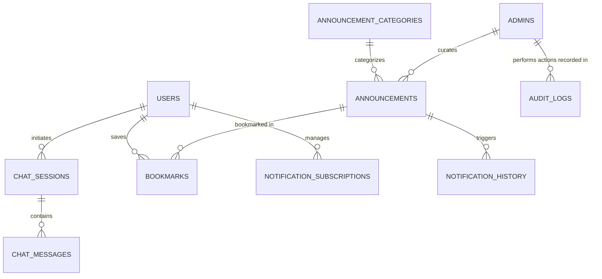

# Srivari AI (శ్రీవారి AI) - Database Schema Specification

This document details the complete relational database schema for **Srivari AI**, compatible with both SQLite and PostgreSQL.

---

## 1. Entity-Relationship Overview

---

## 2. Table Specifications

### 2.1. `users`
Stores mobile app devotee accounts.
| Column | Type | Constraints | Description |
|---|---|---|---|
| `id` | VARCHAR(36) | PRIMARY KEY | UUID identifier |
| `email` | VARCHAR(255) | UNIQUE, NULLABLE | Devotee email address |
| `phone_number` | VARCHAR(20) | UNIQUE, NULLABLE | Mobile phone number |
| `hashed_password` | VARCHAR(255) | NULLABLE | Bcrypt password hash (if registered) |
| `device_id` | VARCHAR(255) | INDEXED, NOT NULL | Unique hardware / installation ID |
| `preferred_language` | VARCHAR(10) | NOT NULL, DEFAULT 'te' | 'te' (Telugu) or 'en' (English) |
| `fcm_token` | TEXT | NULLABLE | Firebase Cloud Messaging device token |
| `is_active` | BOOLEAN | NOT NULL, DEFAULT TRUE | Soft delete / activation flag |
| `created_at` | TIMESTAMP | NOT NULL, DEFAULT CURRENT_TIMESTAMP | Registration timestamp |
| `last_active_at` | TIMESTAMP | NOT NULL, DEFAULT CURRENT_TIMESTAMP | Last interaction timestamp |

### 2.2. `admins`
Stores authorized administrative accounts.
| Column | Type | Constraints | Description |
|---|---|---|---|
| `id` | VARCHAR(36) | PRIMARY KEY | UUID identifier |
| `username` | VARCHAR(100) | UNIQUE, NOT NULL | Admin login username |
| `email` | VARCHAR(255) | UNIQUE, NOT NULL | Admin email |
| `hashed_password` | VARCHAR(255) | NOT NULL | Bcrypt hashed password |
| `full_name` | VARCHAR(150) | NOT NULL | Admin officer name |
| `role` | VARCHAR(50) | NOT NULL, DEFAULT 'super_admin' | 'super_admin', 'editor', 'auditor' |
| `is_active` | BOOLEAN | NOT NULL, DEFAULT TRUE | Status flag |
| `created_at` | TIMESTAMP | NOT NULL, DEFAULT CURRENT_TIMESTAMP | Creation timestamp |
| `last_login_at` | TIMESTAMP | NULLABLE | Last login timestamp |

### 2.3. `announcement_categories`
Classification taxonomy for announcements.
| Column | Type | Constraints | Description |
|---|---|---|---|
| `id` | VARCHAR(36) | PRIMARY KEY | UUID identifier |
| `name_en` | VARCHAR(100) | UNIQUE, NOT NULL | Category name in English (e.g. 'Darshan') |
| `name_te` | VARCHAR(100) | NOT NULL | Category name in Telugu (e.g. 'దర్శనం') |
| `slug` | VARCHAR(100) | UNIQUE, NOT NULL | URL-safe slug ('darshan', 'srivari-seva') |
| `icon_name` | VARCHAR(50) | NOT NULL | Material icon identifier |
| `color_hex` | VARCHAR(10) | NOT NULL | Hex color for UI badge ('#D4AF37') |
| `display_order` | INTEGER | NOT NULL, DEFAULT 0 | Sorting priority |
| `is_active` | BOOLEAN | NOT NULL, DEFAULT TRUE | Category visibility |

### 2.4. `announcements`
Stores scraped and admin-verified TTD announcements and notices.
| Column | Type | Constraints | Description |
|---|---|---|---|
| `id` | VARCHAR(36) | PRIMARY KEY | UUID identifier |
| `category_id` | VARCHAR(36) | FOREIGN KEY (announcement_categories.id) | Linked category |
| `title_en` | TEXT | NOT NULL | Announcement title in English |
| `title_te` | TEXT | NOT NULL | Announcement title in Telugu |
| `content_en` | TEXT | NOT NULL | Full body text in English |
| `content_te` | TEXT | NOT NULL | Full body text in Telugu |
| `source_url` | TEXT | NOT NULL | Direct link to official TTD portal |
| `source_domain` | VARCHAR(100) | NOT NULL | 'news.tirumala.org', 'ttdevasthanams.ap.gov.in', etc. |
| `content_hash` | VARCHAR(64) | UNIQUE, INDEXED | SHA256 hash for deduplication |
| `publication_date`| TIMESTAMP | NOT NULL, INDEXED | Date reported by TTD |
| `is_verified` | BOOLEAN | NOT NULL, DEFAULT TRUE | Verified against official sources |
| `is_quota_alert` | BOOLEAN | NOT NULL, DEFAULT FALSE | Flag for upcoming quota release |
| `quota_date` | TIMESTAMP | NULLABLE | Target date when quota opens online |
| `created_at` | TIMESTAMP | NOT NULL, DEFAULT CURRENT_TIMESTAMP | Ingestion timestamp |
| `updated_at` | TIMESTAMP | NOT NULL, DEFAULT CURRENT_TIMESTAMP | Last update timestamp |

### 2.5. `chat_sessions`
Groups conversational turns for each devotee.
| Column | Type | Constraints | Description |
|---|---|---|---|
| `id` | VARCHAR(36) | PRIMARY KEY | UUID identifier |
| `user_id` | VARCHAR(36) | FOREIGN KEY (users.id), INDEXED | Linked user |
| `title` | VARCHAR(255) | NOT NULL, DEFAULT 'New Devotional Query' | Session title |
| `language` | VARCHAR(10) | NOT NULL, DEFAULT 'te' | 'te' or 'en' |
| `created_at` | TIMESTAMP | NOT NULL, DEFAULT CURRENT_TIMESTAMP | Start timestamp |
| `updated_at` | TIMESTAMP | NOT NULL, DEFAULT CURRENT_TIMESTAMP | Last message timestamp |

### 2.6. `chat_messages`
Individual devotee questions and AI answers with citations.
| Column | Type | Constraints | Description |
|---|---|---|---|
| `id` | VARCHAR(36) | PRIMARY KEY | UUID identifier |
| `session_id` | VARCHAR(36) | FOREIGN KEY (chat_sessions.id), INDEXED | Parent session |
| `sender` | VARCHAR(20) | NOT NULL | 'user' or 'assistant' |
| `content` | TEXT | NOT NULL | Message body text |
| `language` | VARCHAR(10) | NOT NULL | Message language ('te' / 'en') |
| `citations` | JSON | NULLABLE | Array of source links & announcement titles |
| `is_voice` | BOOLEAN | NOT NULL, DEFAULT FALSE | Whether query was spoken via STT |
| `created_at` | TIMESTAMP | NOT NULL, DEFAULT CURRENT_TIMESTAMP | Message timestamp |

### 2.7. `notification_subscriptions`
Devotee topic-level notification preferences.
| Column | Type | Constraints | Description |
|---|---|---|---|
| `id` | VARCHAR(36) | PRIMARY KEY | UUID identifier |
| `user_id` | VARCHAR(36) | FOREIGN KEY (users.id), INDEXED | Linked user |
| `category_id` | VARCHAR(36) | FOREIGN KEY (announcement_categories.id) | Linked category |
| `daily_digest` | BOOLEAN | NOT NULL, DEFAULT TRUE | Receive 8:00 AM IST digest |
| `instant_quota_alerts` | BOOLEAN | NOT NULL, DEFAULT TRUE | Receive immediate quota releases |
| `created_at` | TIMESTAMP | NOT NULL, DEFAULT CURRENT_TIMESTAMP | Preference creation timestamp |

### 2.8. `notification_history`
Record of all push notifications dispatched to devices.
| Column | Type | Constraints | Description |
|---|---|---|---|
| `id` | VARCHAR(36) | PRIMARY KEY | UUID identifier |
| `announcement_id` | VARCHAR(36) | FOREIGN KEY (announcements.id), NULLABLE | Associated announcement |
| `title_en` | VARCHAR(255) | NOT NULL | English push title |
| `title_te` | VARCHAR(255) | NOT NULL | Telugu push title |
| `body_en` | TEXT | NOT NULL | English notification body |
| `body_te` | TEXT | NOT NULL | Telugu notification body |
| `notification_type` | VARCHAR(50) | NOT NULL | 'daily_digest', 'quota_alert', 'breaking' |
| `sent_count` | INTEGER | NOT NULL, DEFAULT 0 | Number of devices targeted |
| `sent_at` | TIMESTAMP | NOT NULL, DEFAULT CURRENT_TIMESTAMP | Dispatch timestamp |

### 2.9. `bookmarks`
Saved announcements for offline devotee reference.
| Column | Type | Constraints | Description |
|---|---|---|---|
| `id` | VARCHAR(36) | PRIMARY KEY | UUID identifier |
| `user_id` | VARCHAR(36) | FOREIGN KEY (users.id), INDEXED | Linked user |
| `announcement_id` | VARCHAR(36) | FOREIGN KEY (announcements.id), INDEXED | Bookmarked announcement |
| `created_at` | TIMESTAMP | NOT NULL, DEFAULT CURRENT_TIMESTAMP | Bookmark timestamp |

### 2.10. `application_settings`
Global system configuration and scraper control parameters.
| Column | Type | Constraints | Description |
|---|---|---|---|
| `key` | VARCHAR(100) | PRIMARY KEY | Configuration key (e.g. 'scraper_interval_hours') |
| `value` | TEXT | NOT NULL | Configuration value (JSON or string) |
| `description` | TEXT | NULLABLE | Human-readable description |
| `updated_at` | TIMESTAMP | NOT NULL, DEFAULT CURRENT_TIMESTAMP | Last modification |

### 2.11. `audit_logs`
Immutable compliance and security activity log.
| Column | Type | Constraints | Description |
|---|---|---|---|
| `id` | VARCHAR(36) | PRIMARY KEY | UUID identifier |
| `admin_id` | VARCHAR(36) | FOREIGN KEY (admins.id), NULLABLE | Performing admin |
| `action` | VARCHAR(100) | NOT NULL | 'login', 'create_announcement', 'sync_scraper' |
| `entity_type` | VARCHAR(50) | NOT NULL | 'announcement', 'user', 'notification' |
| `entity_id` | VARCHAR(36) | NULLABLE | Target record ID |
| `details` | JSON | NULLABLE | Snapshot of changes / parameters |
| `ip_address` | VARCHAR(45) | NULLABLE | Request IP address |
| `created_at` | TIMESTAMP | NOT NULL, DEFAULT CURRENT_TIMESTAMP | Action timestamp |

---

## 3. Database Indexes

To guarantee sub-10ms response times on high-volume queries:
1. `idx_announcements_pubdate`: `announcements(publication_date DESC)`
2. `idx_announcements_cat_date`: `announcements(category_id, publication_date DESC)`
3. `idx_announcements_hash`: `announcements(content_hash)`
4. `idx_chat_messages_session`: `chat_messages(session_id, created_at ASC)`
5. `idx_bookmarks_user_announcement`: `bookmarks(user_id, announcement_id)` UNIQUE
6. `idx_users_device`: `users(device_id)`
7. `idx_audit_logs_created`: `audit_logs(created_at DESC)`

